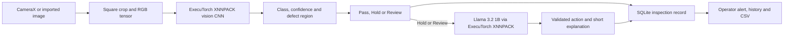

# PartLens

PartLens is an offline Android visual inspection assistant for metal nuts, built for Problem Statement 5 of the Arm Bharat AI-SoC Challenge. A joint classifier and segmentation network identifies good parts, scratches, bends, discoloration, and flipped parts. Low-confidence findings and conflicts between the classifier and mask go to operator review.

## Phase 1 deliverables

| Deliverable | Location |
| --- | --- |
| Android application | [Download the Android APK](https://github.com/Prabhav-05/partlens-arm-ps5/releases/download/phase-1/PartLens-Android.apk) |
| Demo | [Download the demo video](https://github.com/Prabhav-05/partlens-arm-ps5/releases/download/phase-1/PartLens-Demo.mp4) |
| Technical report | [Download the technical report](https://github.com/Prabhav-05/partlens-arm-ps5/releases/download/phase-1/PartLens-Technical-Report.pdf) |
| Source and reproducibility | This repository |

## Run on Android

1. Install the APK on an Arm64 Android 14 or newer phone. The inspection model is included.
2. Download the [Llama 3.2 1B SpinQuant program](https://huggingface.co/software-mansion/react-native-executorch-llama-3.2/resolve/14abd0ac2a4c559114cb4f2944c51249d6656ed5/1b/xnnpack/llama_3_2_1b_xnnpack_spinquant.pte) and its [tokenizer](https://huggingface.co/software-mansion/react-native-executorch-llama-3.2/resolve/14abd0ac2a4c559114cb4f2944c51249d6656ed5/tokenizer.json) to the phone. Allow about 1.1 GB for these local files. The model terms are in [third-party notices](THIRD_PARTY_NOTICES.md).
3. In **Models**, import the two files and run **Run local Llama check**.
4. Use **Live camera** or **Import image**. Center a single nut in steady light. Tap **Inspect part** to record the displayed input. The result is saved immediately, including passes and reviews.
5. **Inspection history** shows saved results after app restarts and offers CSV export.

The APK requests camera access and ships without Android's internet permission. Initial provisioning needs a network connection to download artifacts. Vision, advice, storage, and CSV export run locally after provisioning.

## Architecture



Both inference paths run on the Arm CPU. Camera and vision use one worker, while Llama uses another worker. Only the structured finding reaches Llama. A validated action ID maps to app-managed wording. When a valid Llama action comes with an unsupported explanation, the app keeps the action and shows its own evidence summary. If the action is invalid or the model is unavailable, the record retains labeled default guidance. The operator decision is made by the vision policy. Severity is the largest predicted region's fraction of the image crop and is a prototype proxy for defect extent.

## Build and reproduce

Use Python 3.11, JDK 17, and Android SDK 34. Set `ANDROID_HOME` in your shell or point Android Studio at the SDK. The build uses Gradle 8.2 and the pinned ExecuTorch Android 1.4.1 XNNPACK AAR.

```sh
python3.11 -m venv .local/venv
.local/venv/bin/python -m pip install -r requirements-training.txt
.local/venv/bin/python scripts/fetch_assets.py runtime dataset
.local/venv/bin/python scripts/train_vision.py --device cpu
./gradlew :app:assembleDebug
```

The training script saves its custom, seeded split counts, confusion matrix, and held-out metrics to `.local/vision/metrics.json`. Downloaded data, Llama weights, and build outputs stay outside Git. Dataset source and redistribution terms are in [third-party notices](THIRD_PARTY_NOTICES.md).

To provision one authorized ADB device without using the phone's file picker:

```sh
.local/venv/bin/python scripts/fetch_assets.py llama
scripts/install_debug.sh
```

The report source uses ReportLab 5.1.0 and the [device results](docs/device-results.json). Run `scripts/create_report.py` with the training environment after exporting the vision model. See the report for measured results and verification conditions. The training images use fixed, controlled imaging. The prototype needs a representative fixture and independent factory samples before its output can be used as a production accept/reject decision.
